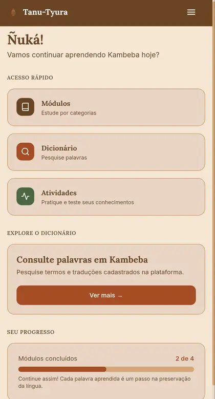
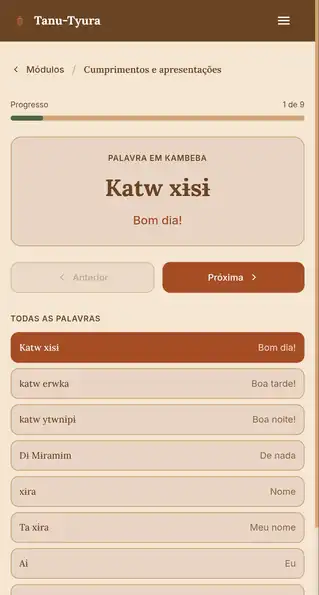
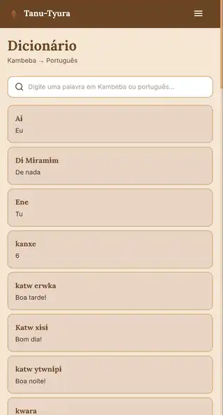
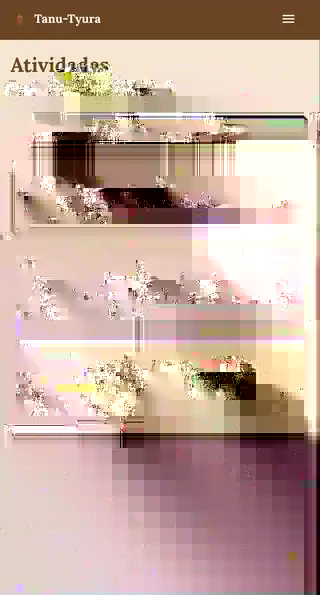
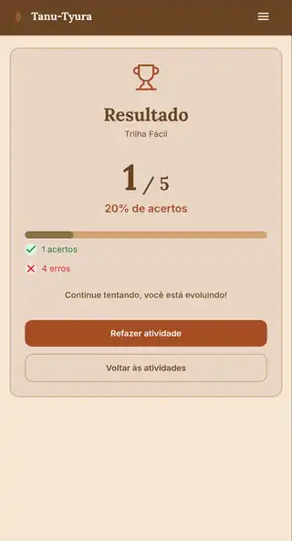

# Tanu-Tyura

**Plataforma web de apoio à aprendizagem da língua Kambeba (Omágua).**

[](https://github.com/DeyvisonS/Tanu-Tyura/actions/workflows/validate.yml)

## Sobre o projeto

O Tanu-Tyura é um projeto acadêmico do curso de Sistemas de Informação. Seu objetivo é apoiar a aprendizagem da língua Kambeba (Omágua) por meio de uma plataforma web com conteúdos organizados por categorias, consulta de vocabulário e atividades educativas.

A proposta busca contribuir para a valorização e a aprendizagem da língua, respeitando as fontes linguísticas utilizadas e a validação dos conteúdos por colaboradores Kambeba.

## Funcionalidades

- Cadastro, login e gerenciamento de sessão dos usuários.
- Página inicial e navegação entre as áreas de aprendizagem.
- Cinco módulos organizados por categorias.
- Dicionário Kambeba–Português com pesquisa por prefixo.
- Atividades de múltipla escolha em três níveis: Fácil, Médio e Avançado.
- Correção das atividades no servidor e apresentação da pontuação confirmada.
- Armazenamento local dos conteúdos públicos e de tentativas realizadas sem conexão.
- Sincronização de tentativas pendentes quando a conexão e uma sessão válida estiverem disponíveis.

## Capturas de tela

As telas abaixo apresentam as principais áreas e recursos da plataforma.

<table>
  <tr>
    <td align="center"><strong>1. Página inicial</strong><br></td>
    <td align="center"><strong>2. Módulos de estudo</strong><br></td>
  </tr>
  <tr>
    <td align="center"><strong>3. Conteúdo de um módulo</strong><br></td>
    <td align="center"><strong>4. Dicionário</strong><br></td>
  </tr>
  <tr>
    <td align="center"><strong>5. Atividades</strong><br></td>
    <td align="center"><strong>6. Questão</strong><br></td>
  </tr>
  <tr>
    <td align="center"><strong>7. Resultado</strong><br></td>
    <td></td>
  </tr>
</table>

## Conteúdo de aprendizagem

O conteúdo está organizado em cinco categorias:

1. Cumprimentos e apresentações.
2. Números.
3. Cores.
4. Família e pessoas.
5. Palavras do cotidiano.

A base atual contém **43 palavras**, conforme a lista validada pela professora Kambeba.

As atividades possuem três níveis de dificuldade, com **cinco questões por nível**, totalizando 15 questões. As alternativas são identificadas por A, B, C e D.

## Tecnologias utilizadas

- **Figma Make:** desenvolvimento assistido e manutenção da interface web.
- **React e TypeScript:** implementação da aplicação.
- **Vite:** ferramenta de desenvolvimento e build.
- **Tailwind CSS:** estilização da interface.
- **Supabase Auth:** autenticação dos usuários.
- **Supabase e PostgreSQL:** banco de dados e serviços de back-end.
- **IndexedDB:** armazenamento local de conteúdos e tentativas offline.
- **Service Worker e Cache Storage:** cache do shell e dos recursos estáticos.
- **GitHub:** versionamento do código-fonte e validação automatizada.

## Estrutura do projeto

A organização principal do repositório é:

```text
Tanu-Tyura/
├── .github/
│   └── workflows/
│       └── validate.yml
├── docs/
│   └── banco-de-dados.md
├── public/
│   └── sw.js
├── src/
│   ├── imports/
│   ├── lib/
│   │   ├── activitySync.ts
│   │   ├── contentPreload.ts
│   │   ├── offline.ts
│   │   └── supabase.ts
│   ├── App.tsx
│   ├── index.css
│   └── main.tsx
├── supabase/
│   ├── functions/
│   ├── migrations/
│   ├── config.toml
│   └── seed.sql
├── utils/
│   └── supabase/
│       └── info.tsx
├── index.html
├── package.json
├── pnpm-lock.yaml
├── tsconfig.json
└── vite.config.ts
```

**Principais diretórios:**

- `src/`: interface e lógica da aplicação.
- `src/lib/`: integração com Supabase, pré-carregamento de conteúdo e funcionamento offline.
- `public/`: arquivos públicos, incluindo o Service Worker.
- `supabase/migrations/`: arquivos SQL que documentam alterações no banco de dados.
- `supabase/seed.sql`: dados iniciais para reprodução em outro ambiente.
- `docs/`: documentação técnica do projeto.
- `.github/workflows/`: automações de validação do repositório.

## Banco de dados

O banco de dados utiliza PostgreSQL por meio do Supabase. No esquema `public`, estão as tabelas `usuarios`, `modulos`, `palavras`, `atividades`, `questoes` e `resultados`. As respostas corretas ficam separadas na tabela `private.gabaritos), dentro do esquema privado.

A correção é realizada exclusivamente pela função `public.corrigir_atividade()`, que consulta os gabaritos no servidor e registra o resultado associado ao usuário autenticado. O identificador UUID da tentativa é reutilizado durante os reenvios para evitar registros duplicados.

Consulte a [documentação detalhada do banco de dados](docs/banco-de-dados.md).

## Funcionamento offline

O funcionamento offline combina três mecanismos:

- **Pré-carregamento global:** durante a inicialização online, a aplicação consulta módulos, palavras, atividades e questões e prepara automaticamente o conteúdo local.
- **IndexedDB:** mantém os stores `modules`, `words`, `activities`, `questions` e `attempts`. O conjunto público esperado é de cinco módulos, 43 palavras, três atividades e 15 questões.
- **Service Worker:** mantém o shell e os recursos estáticos permitidos em cache para permitir a reabertura da aplicação após a preparação inicial.

Quando uma atividade é finalizada sem conexão, as respostas são armazenadas localmente com um UUID e permanecem pendentes. Ao retornar a conexão, a aplicação verifica a sessão e envia as respostas à função `public.corrigir_atividade()`. A pontuação definitiva só é apresentada após a confirmação do servidor.

### Limitações atuais do modo offline

- O primeiro carregamento e a preparação dos conteúdos exigem conexão com a internet.
- Login, cadastro e renovação de uma sessão expirada dependem de conexão.
- A correção definitiva e a sincronização das tentativas exigem conexão.
- Áudios hospedados externamente ainda não estão garantidos para reprodução offline.
- A instalação como PWA e a autorização local para acesso offline ainda são etapas futuras de distribuição.

## Como executar o projeto

### Pré-requisitos

- Node.js 22.
- pnpm 10.
- Acesso ao projeto Supabase configurado para a aplicação.

### Instalação

1. Clone o repositório:

   ```bash
   git clone https://github.com/DeyvisonS/Tanu-Tyura.git
   ```

2. Entre na pasta do projeto:

   ```bash
   cd Tanu-Tyura
   ```

3. Instale as dependências:

   ```bash
   pnpm install
   ```

4. Inicie o servidor de desenvolvimento:

   ```bash
   pnpm dev
   ```

O Vite apresentará o endereço local para acessar a aplicação.

### Verificação e build

Verificar os tipos TypeScript:

```bash
pnpm exec tsc --noEmit
```

Gerar a versão de produção:

```bash
pnpm build
```

Visualizar localmente o build gerado:

```bash
pnpm preview
```

As orientações de configuração e cuidados com o Supabase estão em [SUPABASE_SETUP.md](SUPABASE_SETUP.md).

## Segurança

O Supabase Auth gerencia as credenciais dos usuários. As políticas RLS controlam o acesso aos dados. A função `public.corrigir_atividade()` executa a correção no servidor, consulta `private.gabaritos` e registra o resultado sem expor as respostas corretas ao front-end.

A chave pública do cliente Supabase não substitui as políticas de segurança. Chaves administrativas, senhas e credenciais privadas não devem ser armazenadas no repositório nem expostas no navegador.

## Acessibilidade e usabilidade

O desenvolvimento considera as heurísticas de usabilidade de Nielsen, as diretrizes WCAG e o modelo e-MAG como referências para orientar a interface e sua avaliação. A avaliação sistemática deve ser registrada a partir dos testes realizados.

## Validações

O repositório possui uma automação do GitHub Actions que instala as dependências, verifica os tipos TypeScript e gera o build de produção.

Durante o desenvolvimento, foram relatadas as seguintes verificações:

- Compilação TypeScript (`pnpm exec tsc --noEmit`) e build (`pnpm build`) concluídos com sucesso.
- Correção das atividades testada no preview: Fácil 1/5, Médio 1/5 e Avançado 4/5, conforme os casos de teste utilizados.
- Pré-carregamento testado em Chromium com os dados reais: cinco módulos, 43 palavras, três atividades e 15 questões.
- Persistência dos conteúdos e das tentativas verificada em navegações separadas usando IndexedDB.
- Registro do Service Worker observado no preview do Figma Make.

A validação ponta a ponta da versão sincronizada com o GitHub deve continuar, especialmente a reabertura offline após uma atualização completa e a sincronização autenticada das tentativas.

## Documentação complementar

- [Documentação do banco de dados](docs/banco-de-dados.md)
- [Configuração e cuidados com o Supabase](SUPABASE_SETUP.md)

## Contexto acadêmico

Projeto desenvolvido como trabalho acadêmico do curso de Sistemas de Informação, com foco no apoio à aprendizagem da língua Kambeba (Omágua).
